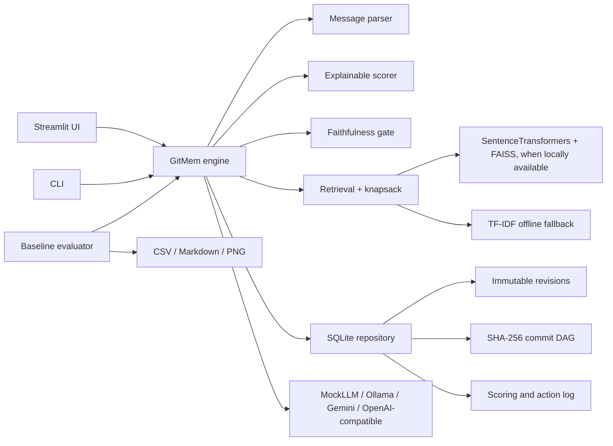

# GitMem

GitMem is an offline-first proof of concept for versioned, user-controlled memory in long-running AI agents. It stores source-linked memory in SQLite, makes retention decisions inspectable, and allows a user to restore an earlier snapshot or selectively rehydrate archived details.

## Run it

Python 3.11 is required.

```bash
python -m streamlit run gitmem/ui/app.py --server.address 0.0.0.0 --server.port 8000
```

The Replit preview runs through the **GitMem Streamlit** workflow. The application uses a local SQLite file at `data/gitmem.sqlite3` by default and starts with a deterministic `MockLLM`; it does not need a model API key or network access.

Run the CLI and tests:

```bash
python -m gitmem --help
python -m gitmem demo
python -m gitmem what-if "What is the launch deadline?" main demo/requirement-alternative
python -m gitmem benchmark
pytest -q
```

The benchmark writes CSV (results and comparative savings), Markdown, and PNG reports under `generated-artifacts/gitmem-benchmark/`. That directory is excluded from version control and deployment packaging.

## What is included

- Typed message ingestion and memory units with importance, recency, repetition, goal relevance, and user-pin scoring.
- Deterministic faithfulness checks for entities, numbers, dates, negation, and unsupported details before a summary can replace active context.
- SQLite-backed immutable text revisions, commit snapshots, hash-linked history, tags, branches, diff, restore, revert, cherry-pick, edit, and selective rehydration.
- Retrieval with an exact bounded knapsack selector, inclusion/exclusion explanations, source attribution, and per-answer token/cost/latency records.
- What-if replay across branches or commit snapshots to diff answers, tokens, and latency.
- Three-way branch merging, explicit conflict review, source-level blame, history bisect, canary checks, and known-good recovery.
- User-confirmed PII text removal with retained content hashes and shred tombstones.
- Streamlit screens for chat, memory inspection, history, operations, blame/bisect, canary checks, and benchmarks with baseline savings metrics.
- Offline `MockLLM`, optional Ollama, Gemini, and OpenAI-compatible adapters.

### Architecture



The default retrieval backend is TF-IDF in this workspace. The implementation attempts to use the local `sentence-transformers/all-MiniLM-L6-v2` model with FAISS only when both packages and model weights are already available; it does not download weights automatically. The vector extra is optional. If installing it is blocked by the configured Python package index, the system remains usable with TF-IDF.

## Demo walkthrough

See [`DEMO_SCRIPT.md`](DEMO_SCRIPT.md) for a guided run. It loads six synthetic sessions and exercises a corrected deadline, reversible compression, canary failure, history bisect, restore versus rehydrate, a branch conflict, and PII removal.

## Evaluation

The included synthetic benchmark compares full-history, sliding-window, rolling-summary, retrieval-based, and GitMem approaches across answer accuracy, critical-information recall, estimated token cost, latency, and recovery success. Results are generated from the implementation rather than hard-coded.

On the bundled six-session, seven-question dataset during this build, GitMem returned all seven expected answers and recovered a deliberately corrupted fact. It used 377 input tokens across the questions; the retrieval baseline used 361, and full-history used 825. This small synthetic run demonstrates bounded context and version recovery, but does **not** establish a general efficiency advantage over retrieval-only systems.

### Optional LongMemEval / LoCoMo subsets

No LongMemEval or LoCoMo data is bundled or automatically fetched. `gitmem.eval.loaders.load_local_subset()` accepts local JSON/JSONL files containing `sessions`, `haystack_sessions`, or `conversation` records and `questions`, `qa`, or single `question`/`answer` pairs. For example:

```bash
python -m gitmem benchmark \
  --dataset ./private-subset.jsonl \
  --dataset-name LoCoMo \
  --confirm-license
```

The explicit confirmation flag is required. Before using a dataset, check the license and terms for the exact release and subset, confirm that the intended research or demonstration use is permitted, and do not redistribute it unless its terms allow redistribution. These benchmarks are useful for long-horizon conversational recall, but one small subset is not sufficient to generalize to production agents or different domains.

## Live model adapters

`MockLLM` is the default and is fully offline. The UI also offers:

- **Ollama**: local server at `OLLAMA_BASE_URL` (defaults to `http://127.0.0.1:11434`).
- **Gemini**: `GEMINI_API_KEY` plus the configured model name.
- **OpenAI-compatible**: `OPENAI_API_KEY`, with optional `OPENAI_COMPATIBLE_BASE_URL` and `OPENAI_COMPATIBLE_MODEL`.

Use the workspace Secrets flow for API credentials; do not put them in source files. Live provider calls can send memory context to that provider, so use them only with data allowed by the provider and your organization.

## Privacy and proof-of-concept limits

The PII workflow requires user confirmation, removes matching text from revisions, redacts linked summaries and saved answers, enables SQLite secure-delete, and retains hashes/tombstones so history integrity can still be checked. **This proof of concept does not encrypt the SQLite database at rest.** Clearing rows is not a substitute for encrypted storage or secure backup erasure. Do not store sensitive production data in this build; use encrypted storage and review SQLite journal/WAL and backup retention before any real deployment.

Scoring and contradiction detection are deterministic heuristics, not a learned policy or a complete semantic verifier. The synthetic benchmark uses the deterministic mock model, and results should be interpreted as a reproducibility check—not a model-quality study. The application currently uses TF-IDF fallback in this workspace because the optional embedding stack could not be resolved from the configured package index.

## Project files

- `gitmem/` — engine, persistence, adapters, retrieval, CLI, evaluation, and UI.
- `gitmem/migrations/` — ordered SQLite schema migrations.
- `gitmem/config/default.yaml` — scoring, retrieval, token budget, and cost configuration.
- `tests/` — foundation and end-to-end behavior tests.
