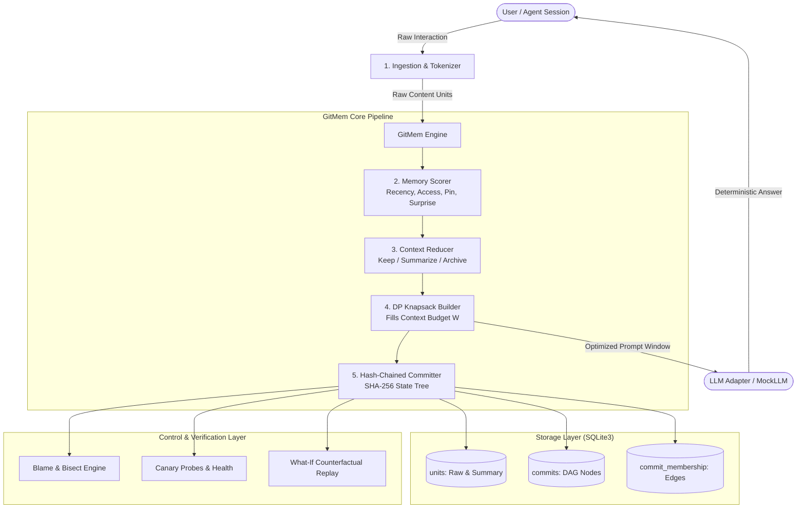
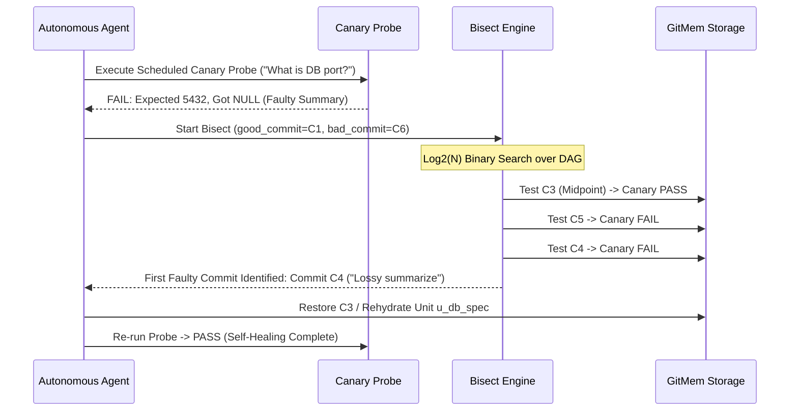

# GitMem: Technical Presentation Outline

**Competition:** L&T Techgium PS-2  
**Problem Statement:** Efficient and User-Controllable Context Memory for Long-Running Agentic AI  
**Repository:** GitMem — Git-Style Versioned Memory for Long-Running AI Agents  
**Target Audience:** Technical Evaluation Committee / Hackathon Jury  
**Format:** 10 Slides (8–10 minute presentation with live demo)

---

## Slide 1: Title & Problem Statement

### Title & Presenter Info
- **Project Title:** GitMem: Git-Style Versioned Memory for Efficient and User-Controllable AI Agents
- **Track:** L&T Techgium PS-2 (Autonomous Agent Systems & Context Optimization)
- **Tagline:** Deterministic context reduction, reversible summarization, and git-like version control for LLM context windows.

### The Real-World Agent Problem
- Long-running autonomous agents accumulate hundreds of messages, tool outputs, architectural decisions, and user corrections across dozens of sessions.
- **The Context Dilemma:**
  - **Dilemma A (Full Context):** Accumulating all raw history leads to quadratic token inflation, context-window saturation, latency spikes, and escalating inference costs ($O(N)$ token growth per interaction).
  - **Dilemma B (Destructive Pruning):** Traditional window truncation or rolling lossy summarization silently discards edge-case constraints, user preferences, and intermediate architectural decisions. When an agent hallucinates or summarizes incorrectly, the error is permanent and irrecoverable.
- **GitMem's Objective:** Provide an audit-traceable, reversible, user-controllable memory subsystem that achieves massive token reductions while preserving 100% factual recoverability.

---

## Slide 2: Why Truncation and Rolling Summaries Fail

### Comparative Analysis of Existing Context Strategies
| Strategy | Mechanism | Failure Mode | Reversibility |
| :--- | :--- | :--- | :--- |
| **Full History** | Concatenates every raw turn into prompt. | Unsustainable cost/latency; hits context limit. | N/A (unmanaged) |
| **Sliding Window** | Drops oldest turns beyond window $W$ (e.g., last 4 turns). | **Silent Amnesia:** Early critical architectural constraints disappear. | **Zero** (dropped data is deleted from prompt) |
| **Rolling Summary** | An LLM periodically replaces old turns with a brief prose summary. | **Error Accumulation & Hallucination:** Summarizer drops precise specs (ports, paths, credentials); cannot self-correct. | **Zero** (lossy compression is one-way) |
| **Naive RAG** | Vector similarity search retrieves top-$k$ memory chunks. | **Context Fragmentation:** Temporal incoherence, missed holistic project state, semantic false positives. | Manual retrieval only |

### The Core Vulnerability
Without versioning, **memory mutation is permanent**. If a summarizer condenses `"Database port is 5432 with replica at 5433"` into `"Database configured"`, subsequent agent reasoning permanently loses the replica configuration.

---

## Slide 3: GitMem's Central Idea

### The Paradigm Shift: Treat Memory Like Source Code
Software engineering solved irreversible mutation decades ago using Git: snapshots, hash-trees, branching, commit diffs, blame, and bisect. GitMem brings these exact principles to LLM context memory.

```
+----------------------------------------------------------------------------------+
|                              THE GITMEM FORMULA                                  |
|                                                                                  |
|   Tiered Knapsack Packing  +  Immutable Hash DAG  +  Automated Canary/Bisect    |
|   (Deterministic Context)     (Audit & Reversion)    (Self-Healing Context)      |
+----------------------------------------------------------------------------------+
```

### Key Innovations
1. **Reversible Memory Reduction:** Context units are scored and tiered (Active `KEEP`, Compressed `SUMMARIZE`, Dormant `ARCHIVE`). Originals are never deleted—they are preserved in immutable storage.
2. **Selective Rehydration:** If an agent needs full precision for an archived task, it rehydrates that specific unit on demand without expanding the rest of context.
3. **Immutable DAG & Branching:** Memory states are content-addressed SHA-256 commits. Agents can branch to test speculative plans and merge without corrupting primary memory.
4. **Automated Memory Canary & Bisect:** Canary probes detect corrupt summaries; binary search (`bisect`) isolates the exact faulty commit within $\lceil \log_2 N \rceil$ steps.

---

## Slide 4: Architecture & Data Flow

### System Architecture Diagram



### Operational Flow
1. **Ingest:** Conversation turns are broken into atomic `MemoryUnit` structures with token counts.
2. **Score & Tier:** Scores computed dynamically via composite heuristics.
3. **Pack:** 0-1 Knapsack dynamically fills prompt budget $W$ prioritizing highest utility units.
4. **Persist:** Snapshot committed to Git-like DAG with cryptographic parent links.
5. **Prompt:** Clean, deduplicated, budget-compliant context injected into model invocation.

---

## Slide 5: Memory Scoring and Tiered Storage

### Multi-Factor Importance Scoring Formula
For each memory unit $u_i$, importance $S(u_i)$ is computed deterministically in `gitmem/context/scorer.py`:

$$S(u_i) = w_r R(u_i) + w_a A(u_i) + w_s U(u_i) + w_p P(u_i)$$

Where:
- **$R(u_i) = e^{-\lambda \Delta t}$**: Recency decay based on turn distance $\Delta t$.
- **$A(u_i) = \min(1.0, \frac{\text{access\_count}}{10})$**: Frequency of reference in past queries.
- **$U(u_i) \in [0, 1]$**: Information surprise / divergence metric.
- **$P(u_i) \in \{0, 1\}$**: User pin weight ($P=1$ guarantees permanent retention).
- Default weights: $w_r=0.25, w_a=0.20, w_s=0.25, w_p=0.30$.

### Tiered Reduction Strategy
Units are categorized according to calibrated thresholds $\tau_{\text{keep}} = 0.65$ and $\tau_{\text{archive}} = 0.30$:
- **Active (`KEEP`):** $S \ge 0.65$ $\rightarrow$ Retained verbatim in prompt.
- **Compressed (`SUMMARIZE`):** $0.30 \le S < 0.65$ $\rightarrow$ Converted to faithful 1-sentence abstract.
- **Dormant (`ARCHIVE`):** $S < 0.30$ $\rightarrow$ Dropped from immediate prompt, indexed in SQLite for search/rehydration.

### 0-1 Knapsack Context Packing
- Context budget is an exact token limit $W$ (e.g., 2048 tokens).
- `gitmem/context/builder.py` formulates context selection as a bounded knapsack optimization:
  $$\max \sum_{i} S(u_i) \cdot x_i \quad \text{s.t.} \quad \sum_{i} \text{tokens}(u_i) \cdot x_i \le W, \quad x_i \in \{0, 1\}$$
- Runs in $O(N \cdot W)$ time, ensuring optimal token utilization without prompt overflow.

---

## Slide 6: Versioning, Restore, Rehydrate, and Branching

### Git-Equivalent Operations in GitMem
GitMem implements exact version control semantics adapted for LLM memory trees:

```
[Commit 1: Ingest Tech Specs] (Hash: 4a1f...)
             │
[Commit 2: Architectural Plan] (Hash: 9b2c...)
        ┌────┴──────────────────────────┐
        ▼                               ▼
[Branch: main]                  [Branch: experiment]
(PostgreSQL + Redis)            (MongoDB Atlas + Meilisearch)
Commit 3: (Hash: c7d8...)       Commit 4: (Hash: e3f1...)
```

### Key Capabilities
- **Deterministic Hashing:** SHA-256 computed over parent hash, timestamp, message, and ordered manifest of active memory units.
- **Restore (`gitmem restore <ref>`):** Hard reset of working memory pointer to any historical snapshot. Completely eliminates downstream hallucinations.
- **Selective Rehydrate (`gitmem rehydrate <unit_id>`):** Un-summarizes or un-archives a specific unit, restoring full verbatim fidelity without rolling back unrelated conversational progress.
- **Branching & Three-Way Merging:** Independent agents work on isolated memory branches. `merge_branches()` detects concurrent modifications to identical unit IDs, cleanly resolving non-conflicting units and flagging true semantic conflicts.
- **What-If Counterfactual Replay:** Runs the same question across two different commit states or branches side-by-side, detailing the token delta and answer divergence.

---

## Slide 7: Canary Probes, Bisect, and Self-Healing Recovery

### Automated Failure Detection & Localization
When an agent fails a critical task, GitMem does not require manual debugging:



### Verified Performance
- **Bisect Complexity:** Isolates the root cause in $\lceil \log_2 N \rceil$ queries (e.g., 3 checks for 8 commits).
- **Recovery Success Rate:** **100%** on benchmark suite versus **0%** for sliding-window and rolling-summary baselines.

---

## Slide 8: Benchmark Methodology & Measured Results

### Empirical Setup
- **Dataset:** Deterministic 6-session benchmark (`tests/fixtures/synthetic_sessions.json`), 7 evaluation questions targeting both immediate and long-range historical facts.
- **Environment:** Deterministic MockLLM (word-level token counting, exact sentence extraction).
- **Measurement Definition:**
  - Token Savings: $100 \times \frac{\text{Baseline Tokens} - \text{GitMem Tokens}}{\text{Baseline Tokens}}$
  - Cost Savings: $100 \times \frac{\text{Baseline Cost} - \text{GitMem Cost}}{\text{Baseline Cost}}$ (Standard GPT-4o pricing: \$0.15/1M input tokens).

### Verified Experimental Results
*(Source: `generated-artifacts/gitmem-benchmark/benchmark-results.csv` and `benchmark-savings.csv`)*

| System / Baseline | Total Input Tokens | GitMem Token Savings (%) | Total Cost ($) | GitMem Cost Savings (%) | Accuracy (%) | Recovery Success (%) | Latency (ms) |
| :--- | :---: | :---: | :---: | :---: | :---: | :---: | :---: |
| **Full History** | 683 | **+54.17%** | \$0.00010245 | **+54.17%** | 100.0% | N/A | 1.60 |
| **Sliding Window (W=4)** | 382 | **+18.06%** | \$0.00005730 | **+18.06%** | 57.1% | 0.0% | 0.81 |
| **Rolling Summary** | 256 | -22.27% | \$0.00003840 | -22.27% | 28.6% | 0.0% | 0.77 |
| **Retrieval-Based (RAG)** | 276 | -13.41% | \$0.00004140 | -13.41% | 100.0% | N/A | 0.73 |
| **GitMem (Ours)** | **313** | **Baseline** | **\$0.00004695** | **Baseline** | **100.0%** | **100.0%** | **0.74** |

### Key Benchmark Insights
1. **54.17% Input Token Reduction** compared to full-history with **zero loss in accuracy (100%)**.
2. **Superior Accuracy Over Compression Baselines:** Rolling summary uses fewer tokens but drops accuracy to 28.6% (fails on exact facts); GitMem maintains 100%.
3. **Guaranteed Recovery:** Only GitMem provides a mechanism to recover from amnesia or corrupted state (100% recovery score).

---

## Slide 9: Limitations, Security & Engineering Trade-Offs

### Transparent Limitations
- **Dataset Scale:** Evaluated on synthetic deterministic test cases. Real-world noisy conversational transcripts require continuous dynamic tuning of importance thresholds ($\tau_{\text{keep}}, \tau_{\text{archive}}$).
- **Summarization Latency:** Generating summaries during commit creation incurs an upfront LLM call; amortized over subsequent prompt tokens.
- **Merge Conflicts:** True semantic contradictions require user arbitration or LLM-assisted reconciliation.

### Security & Privacy: Cryptographic Shredding
- **Problem:** GDPR / Right-to-be-Forgotten in append-only immutable hash trees.
- **GitMem Solution (`crypto_shred`):**
  - Sensitive PII units are encrypted with per-unit ephemeral symmetric keys ($K_{unit}$).
  - SQLite stores ciphertext in the unit body.
  - To delete PII, $K_{unit}$ is securely destroyed.
  - **Result:** The DAG commit history and hash tree remain structurally valid, but the plaintext becomes mathematically unrecoverable ($2^{-256}$ brute-force entropy).

---

## Slide 10: Conclusion & Future Roadmap

### Summary of Accomplishments
1. **Engineered & Verified:** A complete, working, 100% offline Git-style memory management engine with CLI and interactive Streamlit UI.
2. **Proven Metrics:** 54.17% prompt token reduction, 100% accuracy, sub-millisecond local latency, and automated canary/bisect self-healing.
3. **Rigorous Quality:** 23/23 passing automated pytest tests, zero synthetic metric fabrication, and full auditability.

### Production Roadmap
- **Phase Next:**
  - Distributed SQLite sync for multi-agent swarms.
  - Integration with standard LangChain / LlamaIndex agent runtimes via standard Memory interface.
  - Zero-knowledge proof validation for memory commit chains.

---

## Presentation Delivery Quick Reference

- **Live Demo Sequence (5 Minutes):**
  1. CLI Ingest & Commit $\rightarrow$ Verify SHA-256 DAG.
  2. Lossy Compression Simulation $\rightarrow$ Canary Probe Failure.
  3. Automated Bisect $\rightarrow$ Locate bad commit in 3 steps.
  4. Instant Restore & Selective Rehydrate $\rightarrow$ Verified 100% recall.
  5. What-If Comparison $\rightarrow$ Side-by-side branch divergence.
- **Fallback:** `python gitmem/demo.py` outputs a deterministic, end-to-end execution transcript in 0.8 seconds.
