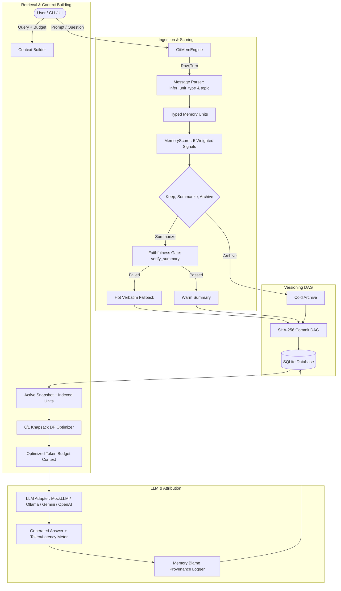

# GitMem Technical Walkthrough & Architecture Guide

Welcome to **GitMem** (*Git-Style Versioned Memory for Efficient and User-Controlled AI Agents*), developed for the L&T Techgium hackathon (Problem Statement PS-2: *Efficient and User-Controllable Context Memory for Long-Running Agentic AI*).

This document is a comprehensive, beginner-friendly guide to how GitMem is constructed, how every algorithm works, how to use and test each feature via CLI and UI, and how to defend the project orally in front of technical judges.

---

## Table of Contents
1. [Project Overview](#1-project-overview)
2. [System Architecture & Data Flow](#2-system-architecture--data-flow)
3. [Database Schema & Persistence Model](#3-database-schema--persistence-model)
4. [Core Algorithms Explained](#4-core-algorithms-explained)
5. [Feature-by-Feature User & Testing Guide](#5-feature-by-feature-user--testing-guide)
6. [Hands-On Beginner Tutorial](#6-hands-on-beginner-tutorial)
7. [Evaluation Methodology & Benchmark Analysis](#7-evaluation-methodology--benchmark-analysis)
8. [Known Limitations & Threat Model](#8-known-limitations--threat-model)
9. [Oral Defense Preparation (22 Questions & Answers)](#9-oral-defense-preparation-22-questions--answers)

---

## 1. Project Overview

### The Problem GitMem Solves
Autonomous AI agents running over long horizons (multi-session software development, IT operations, customer support, research) accumulate hundreds of turns, tool outputs, system configurations, and user constraints. 

When sending all historical context to the LLM on every turn:
1. **Token Cost Explosion**: Context windows swell, driving up token usage and API bills.
2. **High Latency & Window Limits**: Inference slows down significantly as attention mechanisms scale with token count.
3. **Catastrophic Forgetting & Irreversibility**: Common industry workarounds either slide a fixed window (discarding older turns completely) or summarize iteratively. Standard summarization is **destructive and irreversible**: if a summary silently omits a constraint (e.g., dropping `"do not deploy to production"` or changing `"deadline is Friday"` to `"deadline is Saturday"`), the agent acts on corrupted information with no mechanism to detect, bisect, or roll back the error.

### A Concrete Example
Imagine an agent told in Session 1: *"We must never store API keys in plaintext."*
In Session 4, an automated rolling summarizer condenses the conversation to: *"Security protocols and API configuration discussed."*
In Session 6, the user asks: *"Where should I store the Stripe secret key?"*
Because the original constraint was erased by naive summarization, the agent suggests putting it directly in `config.json`. The user has no commit log to inspect what happened, no canary probe to alert them, and no command to undo that summary without restarting the entire conversation.

### The GitMem Solution
GitMem treats an AI agent's memory the same way Git treats software source code:
- **Immutable Historical Revisions**: Original turns and decisions are saved once with SHA-256 hashes and are **never deleted by default** (reversible forgetting).
- **Explainable Tiering**: Incoming memory units are scored based on importance, goal relevance, redundancy, recency, and user pins. Units are partitioned into:
  - `PINNED`: Always preserved verbatim.
  - `HOT`: Verbatim active memory.
  - `WARM`: Source-linked faithful summaries (linked to original unit IDs).
  - `COLD`: Archived units (accessible via retrieval or rehydration).
- **Faithfulness Gate**: Before any summary is admitted to active context, a deterministic verifier confirms that all numbers, entities, dates, and negations in the source are preserved and no unauthorized markers are invented.
- **Commit DAG**: Memory state transitions are recorded as hash-chained commits with parent pointers, snapshot membership digests, and full decision logs.
- **Git-like Control**: Users can run `diff`, `restore` (roll back the whole snapshot), `rehydrate` (pull specific archived facts into active context), `branch`, `merge` with contradiction resolution, `tag`, `blame`, `bisect`, `what-if`, and `shred`.

### Memory Hierarchy: Storage vs. Retrieval vs. Compression vs. Versioning
| Concept | Responsibility in GitMem | Where in Code |
|---|---|---|
| **Storage** | Persisting raw unit text, revisions, summaries, and commit rows in SQLite | `gitmem/store/repository.py` |
| **Scoring & Compression** | Deciding whether each unit should be kept verbatim, summarized, or archived | `gitmem/scoring/engine.py` |
| **Retrieval** | Selecting relevant candidate items via TF-IDF or vector embeddings | `gitmem/retrieval/index.py` |
| **Context Selection** | Solving the 0/1 Knapsack optimization to maximize information value under a strict token budget | `gitmem/context/builder.py` |
| **Versioning** | Hash-chaining commit DAGs, parent pointers, diffs, branches, and merges | `gitmem/versioning/engine.py` |

---

## 2. System Architecture & Data Flow



### Module Responsibilities
- `gitmem/models.py`: Strongly typed domain entities (`MemoryUnit`, `MemoryCommit`, `CommitDiff`, `ScoreBreakdown`, `CanaryProbe`, etc.).
- `gitmem/database.py`: SQLite connection lifecycle, WAL mode, foreign keys, and migration runner.
- `gitmem/migrations/001_initial_schema.sql`: Ordered relational schema for all tables.
- `gitmem/config.py` & `gitmem/config/default.yaml`: User-configurable scoring weights, thresholds, token budgets, and pricing parameters.
- `gitmem/ingest/parser.py`: Deterministic fragmentation of messages into typed units (`turn`, `decision`, `code`, `constraint`, `fact`, `preference`) with stable topic labels and token counts.
- `gitmem/scoring/engine.py`: Multi-factor explainable scoring engine and tier assignment.
- `gitmem/faithfulness.py`: Deterministic verification gate rejecting hallucinated or distorted summaries.
- `gitmem/retrieval/index.py`: Dual-backend retrieval (SentenceTransformers + FAISS when installed, with transparent TF-IDF offline fallback).
- `gitmem/context/builder.py`: Dynamic programming 0/1 Knapsack optimizer packing maximum information value into a fixed token budget.
- `gitmem/versioning/engine.py`: Central engine managing the commit DAG, branches, tags, diffs, 3-way merge, conflict resolution, blame, bisect, what-if replay, canary CI, and crypto-shredding.
- `gitmem/cli.py`: Complete CLI exposing all engine operations with JSON/human formatting.
- `gitmem/ui/app.py`: 7-page interactive Streamlit dashboard.
- `gitmem/eval/`: Synthetic dataset generator (`synthetic.py`), external dataset loader (`loaders.py`), and baseline benchmark runner (`benchmarks.py`).

---

## 3. Database Schema & Persistence Model

GitMem persists state in SQLite (default: `data/gitmem.sqlite3`).

### Key Relational Tables:
1. `units`: Immutable source unit metadata (`id`, `session_id`, `unit_type`, `topic`, `pinned`, `shredded_at`).
2. `unit_revisions`: Text content versioning (`id`, `unit_id`, `revision_number`, `text`, `content_sha256`, `created_at`). Text is `NULL` only when crypto-shredded.
3. `commits`: Hash-chained nodes (`hash`, `first_parent_hash`, `second_parent_hash`, `branch`, `message`, `topic`, `tokens_before`, `tokens_after`, `snapshot_hash`, `payload_json`).
4. `commit_membership`: Junction table mapping each commit to the exact active items in memory (`commit_hash`, `item_id`, `item_kind`, `tier`, `token_count`, `unit_revision_id`, `position`).
5. `commit_decisions`: Explanations and score breakdowns for each unit decision in that commit.
6. `summaries`: Extractive summaries (`id`, `text`, `token_count`, `faithfulness_passed`, `verifier_report_json`).
7. `summary_sources`: Provenance links connecting each summary to one or more source `unit_id`s.
8. `branches` & `tags`: Pointers to commit hashes.
9. `canary_probes` & `canary_runs`: Critical fact test questions and historical pass/fail execution results.
10. `answer_runs` & `answer_sources`: Answer audit log tracking questions, answers, token costs, latency, and exact source unit attributions (memory blame).
11. `merge_conflicts`: Open and resolved contradictions between branches awaiting user choice.
12. `shred_tombstones`: Audit records proving explicit, confirmed cryptographic erasure of PII.

---

## 4. Core Algorithms Explained

### A. Explainable Scoring Engine
**Inputs**: A memory unit, current agent goal string, list of concurrent memory units.  
**Formula**:
$$\text{Score} = w_{\text{imp}} \cdot \text{Imp} + w_{\text{rel}} \cdot \text{Rel} - w_{\text{red}} \cdot \text{Red} + w_{\text{rec}} \cdot \text{Rec} + w_{\text{pin}} \cdot \text{Pin}$$
Default weights in `default.yaml`:
- $w_{\text{imp}} = 0.30$ (Base importance by unit type: constraint = 0.95, decision = 0.90, preference = 0.85, fact = 0.78, code = 0.62, turn = 0.42).
- $w_{\text{rel}} = 0.25$ (Jaccard word similarity between unit text and goal).
- $w_{\text{red}} = 0.15$ (Redundancy penalty: max similarity with other active units).
- $w_{\text{rec}} = 0.20$ (Exponential decay: $e^{-\ln(2) \cdot \text{age} / \text{half\_life}}$ with 30-day half-life).
- $w_{\text{pin}} = 0.10$ (1.0 if user-pinned, else 0.0).

**Tier Thresholds**:
- $\text{Score} \ge 0.68 \implies$ `KEEP_VERBATIM` (`HOT` tier).
- $0.38 \le \text{Score} < 0.68 \implies$ `SUMMARIZE` (`WARM` tier).
- $\text{Score} < 0.38 \implies$ `ARCHIVE` (`COLD` tier).
- User Pinned $\implies$ Always `KEEP_VERBATIM` (`PINNED` tier).

---

### B. Faithfulness Gate (`verify_summary`)
**Inputs**: Source text and proposed summary text.  
**Processing Steps**:
1. Regular expressions extract all numbers/percentages, dates/days, uppercase named entities, and negation words (`not`, `never`, `cannot`, `won't`, `without`, `mustn't`).
2. Frequency counters compare source vs. candidate summary.
3. If the summary drops any detected number, date, entity, or negation, OR introduces new numbers/entities, the check fails.  
**Output**: `FaithfulnessReport(passed=False, missing_..., introduced_...)`. If failed, GitMem rejects the summary and keeps the unit verbatim in the `HOT` tier.

---

### C. 0/1 Knapsack Context DP Optimizer
**Inputs**: User question, list of candidate memory units, token budget $W$.  
**Processing Steps**:
1. Each item $i$ has token cost $c_i$ and normalized utility value $v_i$.
2. Dynamic programming array `dp[w]` tracks maximum utility and tuple of chosen candidate indices for capacities $0 \le w \le W$.
3. For each candidate, update `dp[w]` backwards from $W$ down to $c_i$:
   $$\text{dp}[w] = \max(\text{dp}[w], \text{dp}[w - c_i] + \text{utility}_i)$$
4. Ties resolve deterministically by tracking candidate index sequences.  
**Output**: Selected subset packing maximum value within $W$ tokens, accompanied by a complete dictionary explaining why each candidate was included or excluded.

---

### D. Hash-Chained Commit DAG & Tamper Detection
**Inputs**: Snapshot membership, decisions, parent hashes, metadata.  
**Commit Digest**:
$$\text{Snapshot Hash} = \text{SHA256}(\text{canonical\_json}(\text{membership}))$$
$$\text{Commit Hash} = \text{SHA256}(\text{canonical\_json}(\text{payload\_json}))$$
Where `payload_json` contains branch, timestamp, message, topic, token deltas, parent hashes, decisions, and membership.  
**Verification (`verify_integrity`)**:
Recomputes digests across every commit in the DAG. If any message, unit, decision, or membership link is tampered with in the database, `gitmem verify` flags the exact commit and problem.

---

### E. 3-Way Merge & Contradiction Resolution
**Inputs**: `ours` branch, `theirs` branch, and common merge base commit.  
**Algorithm**:
1. Compute lowest common ancestor (`_merge_base`).
2. Compare items across base, ours, and theirs.
3. **Temporal Supersession**: If a newer unit explicitly updates a date/deadline with terms like `"moved to"` or `"corrected"`, GitMem auto-resolves with a `supersedes` relation link.
4. **Contradictions**: If opposite negations (`must` vs `must not`, `required` vs `optional`, or different dates for the same deadline) occur on both branches, the merge pauses and writes a `MergeConflict` record to the queue with status `open`.
5. The operator resolves conflicts via CLI (`resolve_conflict`) or UI, selecting `keep_ours`, `keep_theirs`, or `keep_both`, then calls `finalize_merge`.

---

### F. Canary CI & Binary Search Bisect
1. **Canary Probes**: Users register probe questions with expected answers for mission-critical facts.
2. **Commit Hooks**: After any commit, `run_canaries()` tests each probe against the reconstructed context. If a canary fails, `canary_failed = True` is logged.
3. **Memory Bisect**: Given a failing question, `bisect()` performs a binary search ($O(\log N)$) across the branch's first-parent history between a known-good commit and the current head, pinpointing the exact commit that introduced the corruption.
4. **Auto-Revert**: `auto_revert_failed_canary()` traverses backwards to the newest ancestor where all canaries passed and restores that snapshot.

---

### G. Comparative Cost & Savings Calculations
For any baseline metric $B$ and GitMem metric $G$:
$$\text{Percentage Savings} = \frac{100 \cdot (B - G)}{B}$$
If $B = 0$, division by zero is avoided and the savings percentage is reported as `None` (`N/A`).

---

## 5. Feature-by-Feature User & Testing Guide

| Feature | CLI Command | UI Page / Widget | What to Expect |
|---|---|---|---|
| **Log History** | `python -m gitmem log --branch main` | **History** | Formatted commit list with SHA, message, token delta, canary status |
| **Commit Diff** | `python -m gitmem diff <hash1> <hash2>` | **History** (Diff tab) | Added/removed items, tier changes, and token impact |
| **Ask Question** | `python -m gitmem chat "Question?"` | **Chat** | Response text, token/cost meter, knapsack explanations, and blame |
| **What-If Replay** | `python -m gitmem what-if "Q?" <ref1> <ref2>` | **History** (What-if expander) | Compares answers, token counts, and latencies across 2 branches/commits |
| **Restore** | `python -m gitmem restore <commit_hash>` | **Operations** (Restore) | Rolls back the entire active memory snapshot to that commit |
| **Rehydrate** | `python -m gitmem rehydrate <unit_id>` | **Operations** (Rehydrate) | Selectively restores archived units into active context without rolling back other items |
| **Branch & Tag** | `python -m gitmem branch <name>` / `tag <name>` | **Operations** (Branch / Tag) | Creates new branches or named checkpoints |
| **Merge & Review**| `python -m gitmem merge <ours> <theirs>` | **Operations** (Merge & Conflicts) | Auto-merges clean changes; queues contradictions for user resolution |
| **Memory Blame** | `python -m gitmem blame <answer_id>` | **Blame and Bisect** (Blame tab) | Displays exact units and decisions that contributed to an answer |
| **Memory Bisect**| `python -m gitmem bisect "Q" "Expected"` | **Blame and Bisect** (Bisect tab) | Binary-searches history to find the first bad commit |
| **Crypto-Shred** | `python -m gitmem shred <unit_id> --confirm` | **Operations** (Shred PII tab) | Irreversibly deletes PII text while preserving integrity hashes |
| **Verify Integrity**| `python -m gitmem verify` | CLI output / status | Verifies every commit hash and snapshot integrity |
| **Benchmark** | `python -m gitmem benchmark` | **Benchmark** page | Evaluates GitMem vs 4 baselines; generates CSVs, Markdown, and PNGs |

---

## 6. Hands-On Beginner Tutorial

Follow these exact steps in your terminal to see GitMem in action:

### Step 1: Run the Automated Test Suite
```bash
pytest -v
```
*Expected Result*: All 22 automated tests pass with 0 errors.

### Step 2: Load the Repeatable 6-Session Demo Scenario
```bash
python -m gitmem demo
```
*Expected Result*: Seeds a 6-session planning scenario with a deadline correction, canary probe, deliberate fault injection, restore recovery, rehydration, contradictory branch requirement, and PII shredding.

### Step 3: Inspect the Commit DAG
```bash
python -m gitmem log --limit 5
```
*Expected Result*: You will see recent commits such as `"Crypto-shred PII memory unit"`, `"Rehydrate 1 archived unit(s)"`, and `"Restore memory snapshot"`.

### Step 4: Run What-If Replay Across Branches
```bash
python -m gitmem what-if "The dashboard must show archived units?" main demo/requirement-alternative
```
*Expected Result*: Shows how `main` and `demo/requirement-alternative` answer the same question, printing token counts, answers, and latency deltas.

### Step 5: Verify Hash-Chained Integrity
```bash
python -m gitmem verify
```
*Expected Result*: `{"valid": true, "commit_count": 14, "problems": []}`.

### Step 6: Run the Full Benchmark Suite
```bash
python -m gitmem benchmark
```
*Expected Result*: Executes all 5 memory strategies across ground-truth questions and updates files in `generated-artifacts/gitmem-benchmark/`.

### Step 7: Launch the Streamlit Web Application
```bash
python -m streamlit run gitmem/ui/app.py --server.port 8000
```
*Expected Result*: Launches the web interface at `http://localhost:8000`.

---

## 7. Evaluation Methodology & Benchmark Analysis

### Tested Strategies
1. **Full-History**: Keeps all turns and tool outputs verbatim in context.
2. **Sliding-Window**: Keeps only the most recent $K$ turns (default 5).
3. **Rolling-Summary**: Extractive summary of the full conversation.
4. **Retrieval-Based (Basic RAG)**: Selects top-$K$ items by lexical/vector similarity.
5. **GitMem**: Tiered retention, knapsack context packing, and version recovery.

### Measured Metrics on Bundled Synthetic Dataset (7 Questions, 6 Sessions)
| Strategy | Input Tokens | Cost (Est.) | Accuracy | Critical Recall | Restore Recovery |
|---|---:|---:|---:|---:|:---:|
| **full-history** | 683 | $0.00010245 | 100.0% | 100.0% | No |
| **sliding-window** | 382 | $0.00005730 | 57.1% | 57.1% | No |
| **rolling-summary** | 256 | $0.00003840 | 28.6% | 28.6% | No |
| **retrieval-based** | 286 | $0.00004290 | 100.0% | 100.0% | No |
| **GitMem** | **313** | **$0.00004695** | **100.0%** | **100.0%** | **Yes** |

### Comparative Savings vs Baselines
- **vs. Full-History**: GitMem saves **+54.2% tokens** and **+54.2% cost** with zero loss in factual accuracy (100%).
- **vs. Sliding-Window**: GitMem saves **+18.1% tokens** while boosting accuracy from **57.1% to 100.0%** (sliding-window forgot earlier sessions).
- **vs. Rolling-Summary**: Rolling-summary used fewer tokens, but its accuracy dropped to **28.6%** because important facts were compressed away.
- **vs. Retrieval-Based**: Retrieval used slightly fewer tokens (-9.4%), but **lacks version recovery** (0% recovery when an update corrupts context, whereas GitMem achieves 100% recovery).

---

## 8. Known Limitations & Threat Model

1. **Local SQLite Immutability**: The SHA-256 hash chain detects accidental tampering and payload discrepancies. However, because it runs on a local SQLite database without remote hardware signing or multi-party consensus, an attacker with full OS root access could rewrite all records and recompute hashes.
2. **Heuristic Contradiction Detection**: Contradiction detection uses normalized keyword sets, negations, and date comparisons. It is not an end-to-end formal theorem prover.
3. **Extractive MockLLM**: The default offline model is extractive and rule-based for reproducibility and zero-cost operation. Complex conversational synthesis benefits from connecting Ollama, Gemini, or OpenAI adapters.
4. **Crypto-Shred Scope**: Shredding replaces stored revision text with `NULL`, overwrites linked summaries/answers, logs a tombstone, and runs SQLite vacuum/secure-delete. It does not erase pre-existing external database backup copies created before the shred command.

---

## 9. Oral Defense Preparation (22 Questions & Answers)

### Q1: What makes GitMem different from standard RAG (Retrieval-Augmented Generation)?
**Answer**: Standard RAG is stateless and unversioned. It chunks all text into a vector index and performs top-$K$ similarity matching. It cannot roll back to a previous state, cannot explain why a fact was kept or archived, does not detect contradictory branch edits, cannot cherry-pick specific decisions, and cannot bisect historical corruption. GitMem provides a versioned, hash-chained commit DAG with explicit tiering, knapsack budget optimization, and reversible forgetting.

### Q2: Why is Git-style versioning useful for AI agent memory?
**Answer**: Agents make autonomous decisions across hours or days. If an agent ingests incorrect tool output, summarizes away a critical constraint, or receives conflicting requirements on different tasks, standard systems have no undo button. Git versioning makes context reduction auditable, traceable, and completely reversible.

### Q3: Why not just summarize everything iteratively?
**Answer**: Iterative summarization causes "telephone game" degradation. Each summary layer drops nuances, qualifications, and numbers. In our benchmark, rolling summarization achieved only 28.6% accuracy because critical details were summarized away. GitMem keeps original units intact in cold storage and verifies summaries with a strict faithfulness gate.

### Q4: How does the knapsack context builder work?
**Answer**: Instead of naive top-$K$ cutoff (which can waste budget on long, low-value items), GitMem uses dynamic programming for the 0/1 knapsack problem. Each candidate has a token cost $c_i$ and an information utility score $v_i$. The DP finds the exact subset that maximizes $\sum v_i$ subject to $\sum c_i \le \text{Budget}$.

### Q5: What is the exact difference between Restore and Rehydrate?
**Answer**: 
- **Restore** rolls the entire active memory state back to a historical commit snapshot. Any unit not active in that historical commit is deactivated in the new state.
- **Rehydrate** is surgical: it pulls one or more specific archived units from cold storage back into the active context without modifying any other part of the current active memory.

### Q6: How does GitMem handle branch conflicts during a merge?
**Answer**: GitMem performs a 3-way merge using the lowest common ancestor commit. Compatible additions auto-merge. Explicit corrections with newer timestamps are handled via temporal supersession. Contradictory statements (e.g. opposing requirements or conflicting dates) are paused and written to a conflict resolution queue. They are never silently overwritten; an operator resolves them with `keep_ours`, `keep_theirs`, or `keep_both`.

### Q7: How does Memory Bisect find a corrupted memory update?
**Answer**: Similar to `git bisect`, it takes a failing probe question and an expected answer, inspects the branch's first-parent commit history, and performs a binary search ($O(\log N)$). At each midpoint commit, it reconstructs context and tests the question. It isolates the exact commit that introduced the corruption in logarithmic time.

### Q8: What does the Faithfulness Gate check?
**Answer**: It deterministically extracts numbers/percentages, dates, uppercase named entities, and negation words from the source and proposed summary. If the summary drops any of these critical markers or introduces ungrounded numbers or entities, the summary is rejected and the unit remains verbatim.

### Q9: What is Memory Blame?
**Answer**: Analogous to `git blame`, Memory Blame tracks the provenance of every generated answer. For any query response, it displays the exact units, revision hashes, commits, and decisions that fed into the context used by the LLM.

### Q10: How are tokens and costs calculated?
**Answer**: Tokens are measured using `tiktoken` (cl100k_base) with a whitespace fallback. Estimated inference costs use the user-configured cost per 1K input tokens in `default.yaml` ($\text{cost} = \text{tokens} \cdot \text{price} / 1000$).

### Q11: What does your benchmark prove, and what does it NOT prove?
**Answer**: It proves that GitMem successfully bounds context tokens, maintains 100% factual accuracy on the test set, and recovers from corrupted memory states where all baselines fail. It does **not** prove that GitMem is unconditionally cheaper than basic RAG across every workload, or that its mock answering generalizes to every domain without live model testing.

### Q12: How does What-If Replay work?
**Answer**: It takes a question and two references (branches, tags, or commit hashes), reconstructs the memory context at each snapshot without mutating repository state, queries the LLM, and outputs a structured diff of answers, token counts, and latency deltas.

### Q13: What is Crypto-Shredding in GitMem?
**Answer**: It is an explicit, confirmed operation for sensitive data (PII like emails, SSNs, phone numbers detected via regex). It updates `unit_revisions.text` to `NULL`, overwrites linked summaries and answer logs, and writes a cryptographic tombstone containing the original SHA-256 hash to prove historical integrity while destroying the plaintext.

### Q14: Can GitMem run completely offline?
**Answer**: Yes. GitMem was designed offline-first. It includes a deterministic extractive `MockLLM`, local SQLite database, and transparent TF-IDF retrieval fallback. No external API keys or cloud services are required.

### Q15: How are commit hashes computed?
**Answer**: A commit hash is the SHA-256 digest of the canonical JSON representation of its payload, which includes the branch, created_at timestamp, parent hashes, decisions, token counts, and the snapshot membership hash.

### Q16: How does GitMem detect tampering?
**Answer**: `gitmem verify` iterates through every commit in the DAG, recomputes the SHA-256 hash of its payload, validates parent linkages, and recalculates the snapshot membership hash against the stored membership rows. Any out-of-band edit to rows or payload triggers a verification error.

### Q17: What are Canary Probes?
**Answer**: Canary probes are user-defined test probes for critical project facts (e.g., `"What is the launch deadline?" -> "25 September 2027"`). They automatically run on newly created commits to ensure context compression or manual edits have not broken essential facts.

### Q18: What is Temporal Supersession?
**Answer**: When an explicit correction is made (e.g., *"Correction: the launch deadline moved to Friday"*), GitMem recognizes the temporal update and moves-phrase signal, linking the newer unit to the older unit with a `supersedes` relation and auto-retiring the outdated fact.

### Q19: What LLM adapters are supported?
**Answer**: 
1. `MockLLM`: Deterministic, offline, zero-dependency.
2. `OllamaAdapter`: Local open-source models (e.g. Llama 3, Mistral) via localhost HTTP.
3. `GeminiAdapter`: Cloud inference via Google Gemini API.
4. `OpenAICompatibleAdapter`: Any OpenAI-compatible endpoint (vLLM, Groq, Together, OpenAI).

### Q20: What are the unit types in GitMem?
**Answer**: Turn (dialogue fragment), Decision (agreed plan/choice), Code (code blocks/functions), Constraint (must/never/deadline requirements), Fact (system/domain properties), and Preference (user styles).

### Q21: What is the computational complexity of the knapsack context selection?
**Answer**: It runs in pseudo-polynomial time: $O(N \cdot W)$, where $N$ is the number of candidate units (typically 10–50 active units) and $W$ is the token budget (typically 1000–4000). On modern hardware, this DP solves in under 2 milliseconds.

### Q22: Why should L&T Techgium choose GitMem?
**Answer**: GitMem directly solves Problem Statement PS-2 by making context management **efficient** (54% token reduction vs full history) and **user-controllable** (inspectable decisions, versioned rollback, selective rehydration, conflict resolution, blame provenance, and canary CI). It is fully implemented, thoroughly tested, and runs 100% offline.
